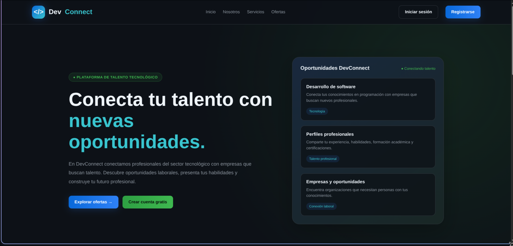
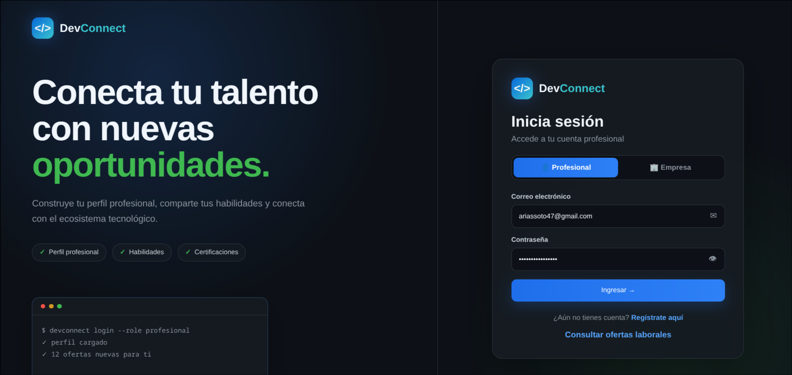
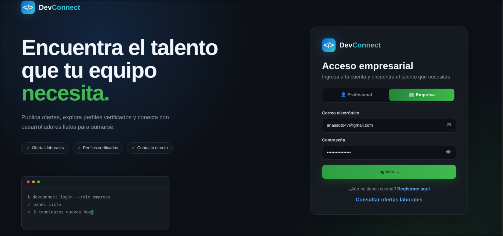
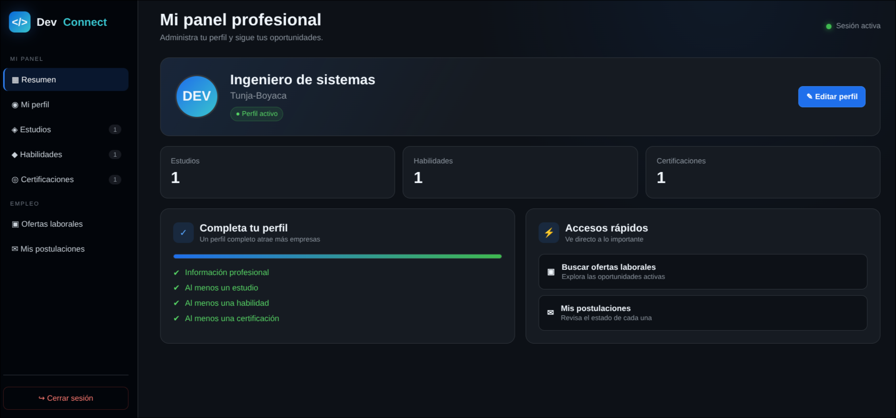
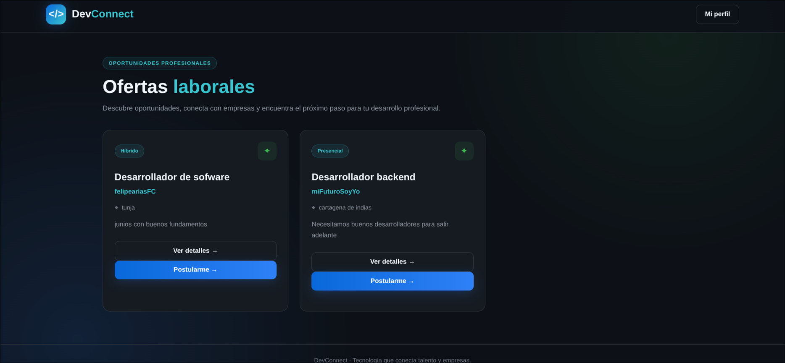
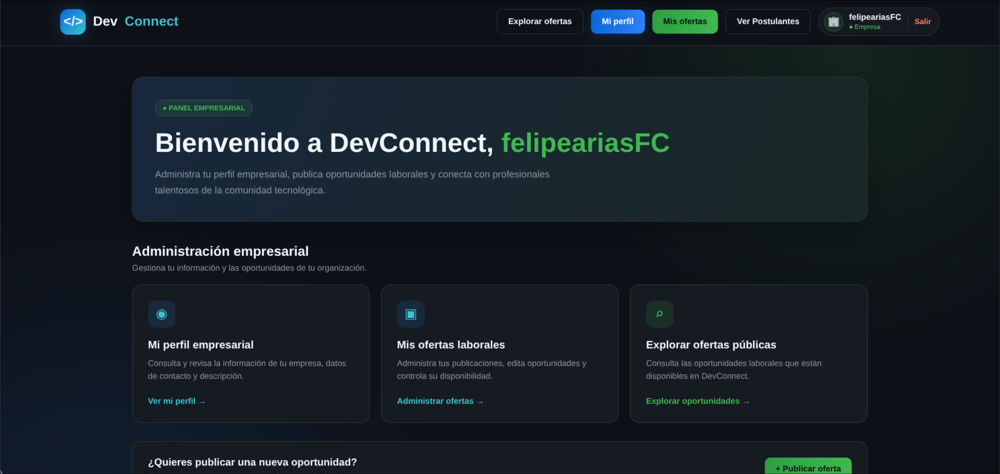
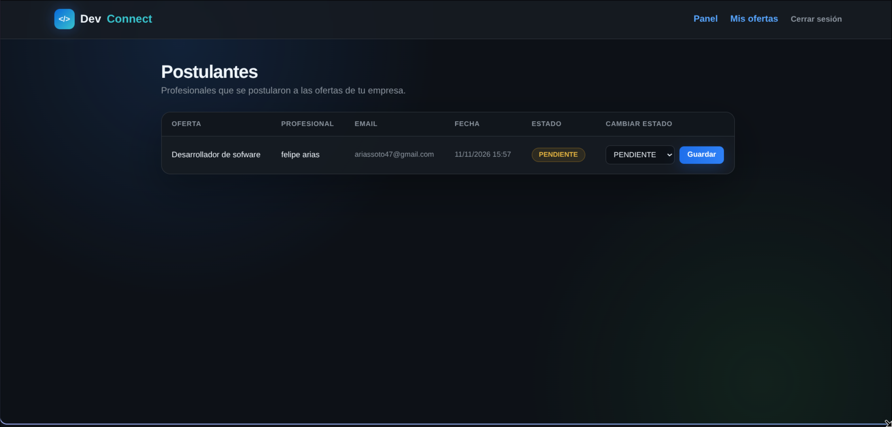
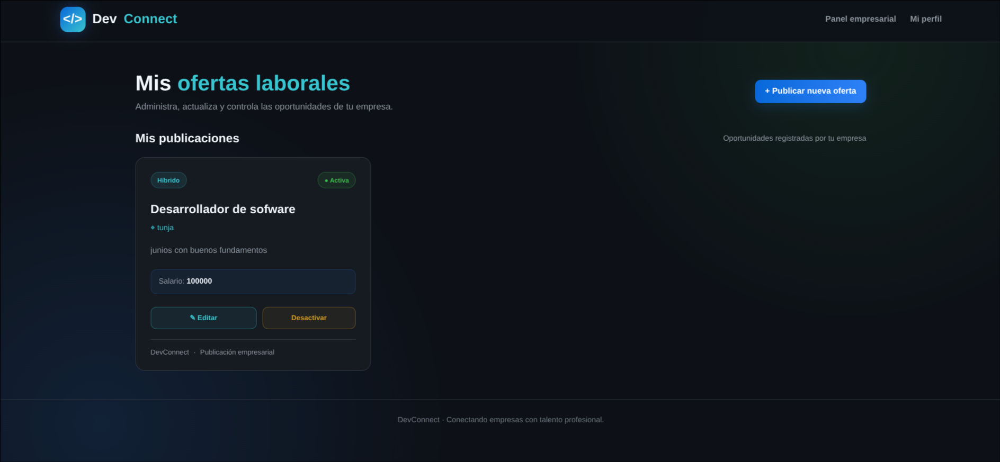

# DevConnect

**Plataforma web para conectar talento tecnológico con oportunidades laborales.**

DevConnect es una aplicación desarrollada con Spring Boot que permite a los profesionales del sector tecnológico
construir su perfil, explorar ofertas laborales y postularse a ellas, mientras que las empresas pueden publicar
ofertas y gestionar a los candidatos recibidos.

---

## Tabla de contenido

- [Descripción](#descripción)
- [Características](#características)
- [Stack tecnológico](#stack-tecnológico)
- [Arquitectura](#arquitectura)
- [Modelo de datos](#modelo-de-datos)
- [Requisitos previos](#requisitos-previos)
- [Instalación y ejecución](#instalación-y-ejecución)
- [Rutas principales](#rutas-principales)
- [Seguridad](#seguridad)
- [Estado del proyecto](#estado-del-proyecto)
- [Equipo](#equipo)

---

## Descripción

**DevConnect** es un portal de empleo especializado en el sector tecnológico. La plataforma integra dos tipos de
usuarios:

- **Profesionales**, que crean un perfil con su experiencia, estudios, habilidades y certificaciones, y se postulan
  a las ofertas disponibles.
- **Empresas**, que se registran, publican ofertas laborales y gestionan el estado de las postulaciones recibidas.

El proyecto fue desarrollado como parte de la asignatura **Gerencia de Software**, aplicando una arquitectura en
capas, validación de datos, seguridad con contraseñas cifradas y una interfaz web renderizada en el servidor.

---

## Características

### Profesionales

- Registro e inicio de sesión con contraseña cifrada (BCrypt).
- Perfil profesional con titular, descripción, experiencia y ciudad.
- Gestión de **estudios**, **habilidades** y **certificaciones** (crear, editar y eliminar).
- Exploración del catálogo de ofertas laborales activas.
- Detalle de cada oferta: descripción, requisitos, ubicación, salario, modalidad y tipo de contrato.
- Postulación a ofertas con validación de duplicados.
- Historial de postulaciones con su estado actual.

### Empresas

- Registro e inicio de sesión independiente del flujo de profesionales.
- Perfil empresarial con descripción, sitio web, teléfono y ubicación.
- Panel de control con resumen de actividad.
- Creación, edición y activación/desactivación de ofertas laborales.
- Visualización de candidatos postulados a sus ofertas.
- Actualización del estado de cada postulación: `PENDIENTE`, `REVISADA`, `ACEPTADA` y `RECHAZADA`.

### Generales

- Página de inicio pública con ofertas destacadas.
- Autenticación basada en sesión con roles separados para profesional y empresa.
- Interceptores que protegen las rutas privadas de cada rol.
- Validación de formularios con Jakarta Bean Validation.
- Interfaz responsive con estilos propios y tema oscuro.

---


---

## Capturas de pantalla

### Página de inicio




### Página de Autenticada







### Experiencia del profesional



### Catálogo de ofertas



### Experiencia de la empresa



### Candidatos de la empresa



### Ofertas de la empresa 




## Stack tecnológico

| Capa | Tecnología |
|------|------------|
| Lenguaje | Java 21 |
| Framework | Spring Boot 4.1.1 |
| Web / MVC | Spring Web MVC + Thymeleaf |
| Persistencia | Spring Data JPA (Hibernate) |
| Base de datos | MySQL / MariaDB |
| Seguridad | Spring Security (BCrypt) + sesiones e interceptores |
| Validación | Jakarta Bean Validation |
| Utilidades | Lombok |
| Build | Maven (Maven Wrapper) |
| Pruebas | JUnit 5 + Spring Boot Test |

---

## Arquitectura

El proyecto sigue una arquitectura en capas:

```
src/main/java/dev/juanv/decconnectcode/
├── config/        # Seguridad, interceptores, configuración web y del usuario actual
├── controller/    # Controladores MVC (páginas y acciones)
├── dto/           # Objetos de transferencia y validación de formularios
├── model/         # Entidades JPA del dominio
├── repository/    # Interfaces de acceso a datos (Spring Data JPA)
├── service/       # Lógica de negocio
└── DecConnectCodeApplication.java

src/main/resources/
├── static/        # CSS y JavaScript
├── templates/     # Vistas Thymeleaf (inicio, login, ofertas, empresa, perfil, etc.)
└── application*.properties
```

---

## Modelo de datos

```
Professional 1 ── 1 ProfessionalProfile
                     ├── 1..* Skill
                     ├── 1..* Education
                     └── 1..* Certification

Company 1 ── * JobOffer 1 ── * Application * ── 1 Professional
```

- La entidad `Application` garantiza **una única postulación por profesional y oferta** mediante una restricción
  de unicidad compuesta.

---

## Requisitos previos

- **Java 21** o superior.
- **MySQL** o **MariaDB** en ejecución.
- No es necesario instalar Maven: el proyecto incluye el **Maven Wrapper**.

---

## Instalación y ejecución

### 1. Clonar el repositorio

```bash
git clone https://github.com/1050602326/DevConnect.git
cd DevConnect
```

### 2. Crear la base de datos

```sql
CREATE DATABASE devconnect CHARACTER SET utf8mb4 COLLATE utf8mb4_unicode_ci;
```

> Hibernate crea y actualiza las tablas automáticamente (`ddl-auto=update`).

### 3. Configurar la conexión

Edita `src/main/resources/application.properties`:

```properties
spring.datasource.url=jdbc:mysql://localhost:3306/devconnect
spring.datasource.username=TU_USUARIO
spring.datasource.password=TU_CONTRASEÑA
```

También existe `application-local.properties` para configuración local (por ejemplo, con MariaDB):

```properties
spring.datasource.username=felipe
spring.jpa.database-platform=org.hibernate.dialect.MariaDBDialect
```

### 4. Ejecutar la aplicación

```bash
./mvnw spring-boot:run
```

En Windows:

```bash
mvnw.cmd spring-boot:run
```

La aplicación estará disponible en **http://localhost:8080**.

### 5. Ejecutar las pruebas

```bash
./mvnw test
```

### 6. Generar el empaquetado

```bash
./mvnw clean package
java -jar target/DecConnectCode-0.0.1-SNAPSHOT.jar
```

---

## Rutas principales

| Método | Ruta | Descripción | Acceso |
|--------|------|-------------|--------|
| GET | `/` | Página de inicio | Público |
| GET / POST | `/register` | Registro de profesional | Público |
| GET / POST | `/login` | Inicio de sesión de profesional | Público |
| POST | `/logout` | Cierre de sesión de profesional | Profesional |
| GET / POST | `/profile` | Ver y editar perfil profesional | Profesional |
| POST | `/profile/education` | Agregar estudio | Profesional |
| POST | `/profile/skill` | Agregar habilidad | Profesional |
| POST | `/profile/certification` | Agregar certificación | Profesional |
| GET | `/offers` | Listado de ofertas activas | Público |
| GET | `/offers/{id}` | Detalle de una oferta | Público |
| POST | `/offers/{id}/apply` | Postularse a una oferta | Profesional |
| GET | `/professional/applications` | Mis postulaciones | Profesional |
| GET / POST | `/company/register` | Registro de empresa | Público |
| GET / POST | `/company/login` | Inicio de sesión de empresa | Público |
| GET | `/company/dashboard` | Panel de la empresa | Empresa |
| GET | `/company/offers` | Ofertas de la empresa | Empresa |
| POST | `/company/offers/save` | Crear oferta | Empresa |
| POST | `/company/offers/update/{id}` | Editar oferta | Empresa |
| POST | `/company/offers/status/{id}` | Activar o desactivar oferta | Empresa |
| GET | `/company/applications` | Candidatos recibidos | Empresa |
| POST | `/company/applications/{id}/status` | Cambiar estado de postulación | Empresa |

---

## Seguridad

- Contraseñas almacenadas con **BCrypt**, nunca en texto plano.
- Sesiones HTTP independientes para profesionales y empresas.
- Interceptores que redirigen al login correspondiente cuando no existe una sesión válida.
- Verificación de propiedad: una empresa solo puede modificar **sus propias** ofertas y postulaciones.
- Validación y saneamiento de formularios en el servidor.

---

## Estado del proyecto

**Funcional y en evolución.** Actualmente se encuentran implementados el registro y autenticación de ambos roles, el
perfil profesional con estudios, habilidades y certificaciones, la gestión de ofertas laborales, las postulaciones
y el seguimiento de sus estados.

### Posibles mejoras

- Ampliar la cobertura de pruebas unitarias y de integración.
- Implementar recuperación de contraseña y verificación por correo electrónico.
- Añadir búsqueda y filtros avanzados de ofertas.
- Migrar la seguridad a roles nativos de Spring Security.
- Incorporar documentación de API y contenedores Docker para el despliegue.

---

## Equipo

| Integrante | Rol |
|------------|-----|
| _Felipe Arias_ | Desarrollo backend / frontend |
| _Juan Diego Verdugo_ | Base de datos / pruebas |
| _Brayan naranjo_ | Requerimientos / tareas |

**Asignatura:** Gerencia de Software — Sexto Semestre
**Repositorio:** [github.com/1050602326/DevConnect](https://github.com/1050602326/DevConnect)

---

Hecho con dedicación por el equipo de **DevConnect**.